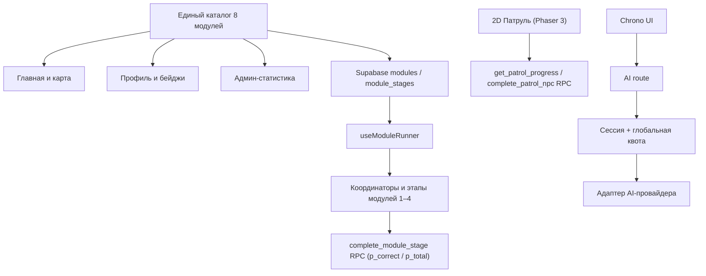

# Анализ проекта InfoQuest

**Дата первичного аудита:** 9 августа 2026 года

**Актуализация:** 22 октября 2026 года
**Область проверки:** весь текущий репозиторий, пользовательские маршруты, четыре доступных учебных модуля (`operator-call`, `fake-link`, `hacked-account`, `scam-or-real`), 2D мини-игра «Патруль цифрового города» (`/patrol`), профиль, админ-панель, Supabase, Google OAuth, AI-помощник Chrono, локализация, доступность, видео и документация.

> Это технический и продуктовый аудит текущей версии. Он не заменяет юридическую проверку политики конфиденциальности и условий использования.

## 0. Статус повторной проверки

Обозначения: **исправлено** — подтверждено кодом, тестом или live-схемой; **частично** — основная защита работает, но остаётся проверяемая часть; **не исправлено** — замечание всё ещё воспроизводится; **внешняя проверка** — состояние нельзя доказать репозиторием.

| Пункт | Статус на 22 октября 2026 года | Подтверждение и остаток |
|---|---|---|
| P0.1 Google OAuth secret | Внешняя проверка | Секрет отсутствует в отслеживаемых файлах, но удаление старого secret и работу нового нужно подтвердить в Google Cloud и Supabase |
| P0.2 RO-финал | Исправлено в коде | RU/RO используют единый типизированный контракт; полного браузерного прохождения всех фаз RO в CI пока нет |
| P0.3 Privacy и AI consent | Частично | Реальный поток текста/аудио, согласие, несовершеннолетние и IP-отпечаток описаны; юридическое заключение и приватный контакт ещё нужны |
| P0.4 AI-доступ и расходы | Частично | Сессия, роли, Supabase-квоты, общий запросный бюджет, конкурентный lock и timeout работают; денежный hard cap BotHub не подтверждён |
| P1.1 Каталог 8 модулей | Исправлено | Один каталог используется главной, профилем, админкой и live Supabase: 8 модулей × 8 этапов, максимум 800 XP (4 доступны, 4 «Скоро») |
| P1.2 Защита прогресса и расчёт очков | Исправлено 17 октября 2026 | Прямые записи закрыты, порядок проверяет RPC; миграция `20261017120000_server_validated_stage_score.sql` перевела RPC `complete_module_stage` на приём пары `(p_correct, p_total)` и серверный расчёт `score = round(100 * p_correct / p_total)` |
| P1.3 Реальный прогресс на главной | Частично | XP, щит и бейджи читаются из Supabase; центральная иллюстрация больше не затемняется при 0 XP, прогресс меняет только свечение; основной CTA и для вошедшего пользователя всё ещё ведёт на `/login` |
| P1.4 Последовательное открытие этапов | Исправлено | Ограничение действует в UI (`useModuleRunner`) и RPC Supabase для всех четырёх доступных модулей |
| P1.5 Клавиатура и таймеры | Исправлено в коде | Интерактивные цели стали `button`, добавлены focus-ring, `aria-pressed`, `aria-live`, перевод фокуса и пауза таймеров; нужен ручной screen-reader тест |
| P1.6 Субтитры | Не исправлено | У видео первого модуля нет WebVTT `<track kind="captions">` и синхронных субтитров |
| P1.7 Локализация и размер клиентских чанков | Исправлено в части архитектуры (октябрь 2026) | `<html lang>` исправлен для RU/RO; двуязычные словари модулей, Chrono и legal-документов больше не попадают в клиентский бандл целиком — серверная страница передаёт только активную локаль `content={...Content[locale]}` |
| P1.8 AI multipart | Исправлено в коде 13 августа 2026 | До внешнего AI проверяются Content-Length, 4 МиБ, сигнатура, метаданные и длительность 0,5–60 с; WAV проходит RMS-порог, все форматы — проверку пустой и максимум 6000 символов расшифровки |
| P1.9 Quality gate | Частично | Локально lint, TypeScript, unit/contract-тесты и build проходят; найдены публичные Playwright smoke-тесты и авторизованные сценарии |
| Роли и блокировки | Частично | Пять ролей и email/account-блокировка работают; IP-блокировка закрывает локализованные страницы и запись прогресса, но `/api/ai` не входит в matcher proxy и требует отдельной IP-проверки |
| Публикация модулей 2–4 | Исправлено 13 октября 2026 | Модули `fake-link`, `hacked-account` и `scam-or-real` опубликованы в каталоге и миграциях (`20261013120000`–`20261013150000`), имеют по 8 этапов на RU/RO и используют общий `useModuleRunner` |
| 2D-игра «Патруль цифрового города» (`/patrol`) | Исправлено 19 октября 2026 | Реализована 2D-игра на Phaser 3 (`PatrolGame`, `patrol-scene`, `DialogueScene`, `RoadMapGenerator`), 4 NPC-сценария и серверное сохранение в `patrol_progress` / `patrol_stage_progress` через RPC (`20261019120000_patrol_progress.sql`) |
| Архитектура модулей, админки и Chrono | Исправлено (август–октябрь 2026) | Координаторы модулей ≤ 300 строк, файлы этапов, админки (`src/app/[locale]/admin/dashboard/`) и чата Chrono (`src/components/ai/chat/`) ≤ 400 строк; бюджет закреплён контрактными тестами |
| Архитектура AI | Исправлено 10 августа | Route отвечает за auth/consent/quota/timeout, OpenAI-совместимые endpoints и модели изолированы интерфейсом `AiProvider` |
| Supabase types/env | Исправлено 10 августа 2026 | Клиенты типизированы общей схемой `Database`; production fallback удалён, обязательные env проходят единую fail-fast проверку |
| Route boundaries/заглушки | Исправлено 10 августа 2026 | Пустые маршруты получили локализованные экраны; добавлены RU/RO `loading.tsx`, `error.tsx` с повтором запроса и полноценный `not-found.tsx` |
| Медиа | Частично исправлено 10 августа 2026 | MP4 уменьшены с 79,61 до 20,67 МиБ и защищены media budget; субтитры отложены по решению команды |
| UX и доступность P2 | Исправлено в коде 10 августа 2026 | Dialog, скрытая кнопка, typewriter, AI-status, пороги риска, Boss HP, слайдер, footer и локализованный QR исправлены; остаются ручное тестирование и продуктовый выбор гостевого режима |
| Незавершённые/устаревшие части | Исправлено (август–октябрь 2026) | Пустые заготовки удалены, README, `docs/mvp-scope.md` и `docs/application-overview.md` актуализированы под 4 модуля и 2D-патруль, добавлены sitemap, robots, OpenGraph, canonical и hreflang |
| Definition of Done пилота | Подготовлено 10 августа 2026 | Зафиксированы 8 обязательных release gates, доказательства, stop-условия и форма GO/NO-GO; текущий статус — NO-GO до закрытия внешних и технических блокеров |
| Полное описание приложения | Актуализировано 22 октября 2026 | `docs/application-overview.md` описывает продукт, пользователей, маршруты, модули 1–4, 2D-патруль, роли, AI, Supabase, архитектуру, безопасность, доступность, тесты, deployment и границы MVP |
| Главная страница по новому макету | Исправлено 12–13 августа 2026 | Добавлены hero с двумя CTA, центрированная верхняя навигация, три шага расследования, 8 категорий-фильтров дел, публичное мини-задание, слайдер, шесть навыков, реальный прогресс и бейджи, три аудитории, Chrono AI, материалы и FAQ |
| Режимы и UX Chrono AI | Исправлено 13 августа 2026 | Переключатель «Анализатор / Чат», пять быстрых сценариев, вкладки текста/аудио, таймер записи до 60 с, 4 этапа ожидания аудиоанализа, read-only RPC остатка квот, компактное согласие, мобильная адаптация и доступные имена контролов |

## 1. Краткий вывод

InfoQuest представляет собой зрелый двуязычный образовательный продукт о цифровой безопасности. В проекте реализованы четыре полных учебных модуля по 8 этапов (`operator-call`, `fake-link`, `hacked-account`, `scam-or-real`), 2D мини-игра «Патруль цифрового города» (`/patrol`) на Phaser 3, серверная проверка игровых результатов, вход через Google, профиль с прогрессом и бейджами, админ-панель и AI-помощник Chrono с анализом текста и аудио.

При этом перед открытым тестированием со школьниками нужно закрыть подтверждаемые организационные и внешние остатки:

1. подтвердить отзыв ранее раскрытого Google OAuth Client Secret и проверить новый secret на production;
2. пройти румынские финалы модулей в браузере и расширить E2E-покрытие;
3. юридически проверить обновлённую политику и назначить приватный контакт для запросов о данных;
4. установить и проверить денежный hard cap/уведомления у AI-провайдера;
5. убедиться в зелёном GitHub Actions и настроить секрет авторизованной тестовой сессии `E2E_AUTH_STATE_B64`;
6. добавить субтитры к видео первого модуля до пилота с учениками.

### Оценка состояния

| Направление | Состояние | Вывод |
|---|---|---|
| Концепция и визуальный стиль | Сильное | Узнаваемый образ, понятная тема, хорошая игровая подача |
| Главная страница | Полноценный публичный игровой лендинг | Экран соответствует утверждённому макету; щит, XP и бейджи связаны с Supabase |
| Модули 1–4 (`operator-call`, `fake-link`, `hacked-account`, `scam-or-real`) | Полностью доступны | Все 4 модуля имеют по 8 этапов на RU/RO, работают через единый `useModuleRunner` и серверный расчёт `score` (`p_correct`/`p_total`); в модуле 1 пока нет субтитров к видео |
| Модули 5–8 | Контент в подготовке | Модули закрыты как «Скоро»; маршрут `/modules/deepfake-detective` показывает локализованную заглушку |
| 2D-игра «Патруль цифрового города» (`/patrol`) | Доступна | Игра на Phaser 3 с процедурной картой дорог, 4 NPC-сценариями на RU/RO, шкалой «Тени» и серверным сохранением прогресса (`get_patrol_progress`, `complete_patrol_npc`) |
| Supabase и профиль | Полноценный пользовательский dashboard | Обзор, миссии, награды и квесты разделены на локализованные страницы; 8 модулей, 8 наград, 64 этапа и 800 XP синхронизированы с Supabase |
| Админ-панель | Полноценный MVP-dashboard | Обзор и четыре отдельные страницы связаны общей адаптивной навигацией; реальные показатели, восемь модулей, квесты, AI-бюджет, пять ролей и блокировки связаны с Supabase |
| Отдельные квесты | Работает в live Supabase | Рубрика добавлена в admin; таблица `quests` поддерживает RU/RO, статусы и JSON-конфигурацию, защищена RLS администратора |
| AI Chrono | Защищённый MVP | Два режима («Анализатор» и «Чат»), роли, приватность, устойчивые квоты, общий запросный бюджет и таймаут работают; денежный cap BotHub требует внешнего подтверждения |
| Доступность | Хорошая базовая | Игровые цели, таймеры, Dialog, Typewriter и контролы Chrono доступны с клавиатуры; видео первого модуля пока без субтитров |
| Автоматические проверки | Локально зелёные | Локальный `npm run check` (lint, typecheck, unit/contract, build) проходит; авторизованный E2E в CI зависит от секрета сессии |
| Готовность к production-пилоту | Средняя–высокая | Техническое ядро готово; требуется закрытие внешних организационных и юридических пунктов |

## 2. Что уже сделано хорошо

- Цельная дизайн-система: неоновая палитра, единые карточки, Orbitron/Rubik, узнаваемый щит и персонажи.
- Главная адаптируется под мобильный и большой экран; у большинства кнопок достаточный размер касания.
- На главной показаны все восемь сюжетных миссий: четыре доступные миссии визуально отделены от четырёх будущих.
- Четыре учебных модуля содержат теорию, разборы/видеоэтапы, по четыре игровые механики и финальную схватку.
- Отдельная 2D-игра «Патруль цифрового города» (`/patrol`) закрепляет навыки в интерактивной городской среде на Phaser 3.
- Профиль, модули, патруль и админ-панель проверяют пользователя на сервере через Supabase.
- Серверная RPC `complete_module_stage` не доверяет клиентскому счёту и вычисляет `score` на сервере из `(p_correct, p_total)`.
- Клиентские бандлы модулей получают словарь только для активной локали с серверной страницы маршрута.
- RLS включён, чтение пользовательских данных ограничено через `auth.uid()`.
- Админская RPC дополнительно проверяет администратора; выполнение для `anon` и `public` отозвано.
- OAuth-переадресация `next` ограничена внутренними маршрутами `/ru` и `/ro`.
- AI-ключ находится только на сервере; `.env.local` не отслеживается Git.
- AI-ответ имеет структурированный формат: вердикт, риск, признаки, действия и предупреждение.
- Текст AI выводится как обычный React-текст, без опасного HTML.
- Аудиофайлы и расшифровки не сохраняются приложением в Supabase.
- Для видео используется `preload="metadata"`, изображения персонажей подключаются через `next/image`.
- В CSS есть общий видимый фокус и поддержка `prefers-reduced-motion`.
- `npx tsc --noEmit` проходит без ошибок.

## 3. Блокеры следующего публичного релиза — P0

### P0.1. Нужно подтвердить ротацию Google OAuth Client Secret

Client Secret ранее был опубликован в переписке по проекту. В текущем репозитории и его отслеживаемых файлах этот секрет не найден, но после раскрытия его следует считать скомпрометированным до подтверждения ротации.

**Что сделать:**

1. создать новый Client Secret в Google Cloud;
2. заменить его в Supabase → Authentication → Providers → Google;
3. удалить старый secret в Google Cloud;
4. проверить вход на production и localhost;
5. больше не отправлять secret в чат, скриншоты или Git. Client ID секретом не является.

### P0.2. Румынская финальная игра падала при взаимодействии — исправлено 9 августа 2026 года

RO-данные переведены на `correctTargets[]` и `answers[]`, а оба языковых финала проверяются через единый `OperatorFinalContent` с оператором `satisfies`. Контент модулей 2–4 также строго типизирован для обеих локалей.

### P0.3. Политика не описывала реальную AI-обработку — техническая часть исправлена 9 августа 2026 года

Обновлены RU/RO политика и условия, добавлено обязательное согласие перед отправкой в Chrono, подготовлен `docs/privacy-legal-review-checklist.md`.

**Осталось до пилота:** назначить приватный email для запросов о данных, получить письменные ответы BotHub по хранению/субобработчикам и передать политику вместе с чек-листом специалисту по защите данных в Молдове.

### P0.4. Авторизация, устойчивые квоты и проектный бюджет исправлены; остаётся денежный cap провайдера

Страница Chrono и `src/app/api/ai/route.ts` требуют действующую Supabase-сессию и роль `student`, `teacher` или `administrator`. В Supabase работают атомарные лимиты: 3 аудиоанализа в сутки, 20 общих запросов в сутки и 300 в месяц на пользователя, 100 запросов в сутки и 2000 в месяц на весь проект, конкурентный lock и timeout.

**Осталось:** установить денежный/Caps spending limit и уведомление в личном кабинете AI-провайдера.

## 4. Высокий приоритет — P1

### P1.1. Единый каталог восьми модулей и публикация модулей 1–4 — исправлено (август–октябрь 2026)

В `src/data/module-catalog.ts` и `src/data/module-catalog-meta.ts` зафиксированы канонические ID, порядок, локализованные названия, доступность, маршруты, бейджи, восемь этапов и распределение 100 XP на модуль. Четыре модуля (`operator-call`, `fake-link`, `hacked-account`, `scam-or-real`) имеют статус `playable` как в TypeScript-каталоге, так и в миграциях Supabase (`20261013120000`–`20261013150000`).

### P1.2. Защита прогресса и серверная проверка игровых результатов — исправлено 17 октября 2026 года

У роли `authenticated` отозваны прямые `insert/update` для `module_progress` и `module_stage_progress`. Миграцией `20261017120000_server_validated_stage_score.sql` RPC `complete_module_stage` переведена на сигнатуру `(p_module_id, p_stage_index, p_correct, p_total)`:

- для пассивных этапов (`theory`, `video_explanation`, `video_example`) сервер автоматически ставит `score = 100`;
- для игровых этапов и финала сервер проверяет корректность диапазона `0 <= p_correct <= p_total` и сам вычисляет `round(100 * p_correct / p_total)`;
- доверенный клиентский `score` больше не принимается.

Для 2D-игры «Патруль» (`20261019120000_patrol_progress.sql`) прямые записи в `patrol_progress` и `patrol_stage_progress` также закрыты: обновление `shadow_pct` и списка пройденных NPC выполняется только через серверную RPC `complete_patrol_npc`.

### P1.3. Главная использует реальный прогресс — исправлено 9 августа 2026 года

XP, восемь сегментов центрального щита и бейджи используют единый результат чтения `module_progress`.

### P1.4. Игровая последовательность восстановлена — исправлено 9 августа 2026 года

Интерфейс открывает первый незавершённый этап и уже пройденные этапы. Та же последовательность независимо проверяется в Supabase RPC.

### P1.5. Клавиатурное управление и пауза таймеров — исправлено 10 августа 2026 года

Интерактивные фрагменты и визуальные цели оформлены как `button` с `aria-pressed`, доступными именами и видимым `focus-ring`. Таймеры поддерживают паузу.

### P1.6. Видео не имеют субтитров

Видео первого модуля и демонстрационное видео выводятся без `<track kind="captions">`. План подключения WebVTT зафиксирован в `docs/mvp-scope.md`.

### P1.7. Локализация и изоляция словарей по локали — обновлено в октябре 2026 года

- `<html lang>` вычисляется из locale и корректен для `/ru/*` и `/ro/*`.
- Двуязычные словари модулей (`operator-call`, `fake-link`, `hacked-account`, `scam-or-real`), Chrono и юридических документов передаются с серверных страниц только для активной локали (`content={...Content[locale]}`), что проверено контрактным тестом в `tests/unit/project-contracts.test.ts`.

### P1.8. Таймаут и защита audio multipart добавлены — исправлено 13 августа 2026 года

Проверяются `Content-Length`, лимит 4 МиБ, сигнатура байтов, длительность 0,5–60 с, порог громкости RMS для WAV и содержательность расшифровки (до 6000 символов).

### P1.9. Локальный quality gate

`npm run lint`, `npm run typecheck`, `npm run test` и `npm run build` проходят локально.

### P1.10. IP-блокировка на прямом AI endpoint

Роль `blocked` закрывает UI и AI по аккаунту/email, а `src/proxy.ts` проверяет IP-блокировку для локализованных маршрутов. Рекомендуется дополнительно вызывать проверку IP-отпечатка непосредственно в `/api/ai`.

## 5. Видео и медиа

`public/video` оптимизирован до 20,67 МиБ (экономия ~74% от исходных 79,61 МиБ) и защищён контрактным тестом (каждый ролик ≤ 12 МиБ, весь набор ≤ 25 МиБ). В `public/game/sprites/` размещены спрайт-листы и XML-атласы для 2D-игры «Патруль».

## 6. Архитектура и поддерживаемость — P2

### 6.1. Декомпозиция модулей, админ-панели и Chrono — исправлено (август–октябрь 2026)

- Все четыре учебных модуля (`OperatorCallModule`, `FakeLinkModule`, `HackedAccountModule`, `ScamOrRealModule`) построены по единому шаблону: компактный координатор (≤ 300 строк) + отдельные файлы этапов в подпапке модуля + общий контроллер `useModuleRunner`.
- `src/components/ai/AiHelpChat.tsx` разделён на координатор и модули в `src/components/ai/chat/` (`composer.tsx`, `message-bubble.tsx`, `quick-examples.tsx`, `thinking-card.tsx`, `use-chrono-audio.ts`, `wav.ts`, `types.ts`).
- `src/app/[locale]/admin/page.tsx` разделён на страницу и модули в `src/app/[locale]/admin/dashboard/` (`charts.tsx`, `copy.ts`, `quest-card.tsx`, `types.ts`, `ui.tsx`, `user-card.tsx`).
- Контрактные тесты контролируют лимит размера файлов (≤ 400 строк, для координаторов и страницы админки ≤ 300 строк).

### 6.2. Типизированная граница Supabase — исправлено 10 августа 2026 года

`src/lib/supabase/database.types.ts` типизирует таблицы и RPC для всех клиентов (`client.ts`, `server.ts`, `proxy.ts`).

### 6.3. Изоляция клиентских бандлов от неактивной локали — исправлено в октябре 2026 года

Клиентские компоненты не импортируют двуязычные словари значениями (`import type` разрешён). Серверные страницы маршрутов передают в клиентские компоненты только ветку текущего языка (`content={...Content[locale]}`), а общие числовые константы и идентификаторы модулей вынесены в лёгкий `src/data/module-catalog-meta.ts`.

### 6.4. Route-level устойчивость и заглушки — исправлено 10 августа 2026 года

Локализованные `loading.tsx`, `error.tsx`, `not-found.tsx` и информационные экраны `PlaceholderRoutePage` работают для всех вспомогательных и будущих маршрутов.

### 6.5. Fail-fast проверка переменных окружения Supabase — исправлено 10 августа 2026 года

Скрытые production fallback удалены; все клиенты используют единый валидатор `src/lib/supabase/config.ts`.

### 6.6. Единая модель ролей и блокировка аккаунтов — исправлено 10 августа 2026 года

Пять ролей (`user`, `student`, `teacher`, `administrator`, `blocked`), аудит ролей и блокировка аккаунта/IP работают через защищённые RPC.

## 7. Реализованная целевая архитектура



Ключевая фактическая структура:

```text
src/
  data/
    module-catalog.ts
    module-catalog-meta.ts
    operator-call.ts
    fake-link.ts
    hacked-account.ts
    scam-or-real.ts
    patrol.ts
    chrono-content.ts
  features/
    modules/
      runner/
        use-module-runner.ts
    ai-help/
      server/
        audio-validation.ts
        openai-compatible-provider.ts
  components/
    modules/
      OperatorCallModule.tsx + operator-call/
      FakeLinkModule.tsx + fake-link/
      HackedAccountModule.tsx + hacked-account/
      ScamOrRealModule.tsx + scam-or-real/
    game/
      PatrolGame.tsx
      patrol-scene.ts
      DialogueScene.ts
      RoadMapGenerator.ts
      RoadNetwork.ts
    ai/
      AiHelpChat.tsx + chat/
  app/
    [locale]/
      modules/ (operator-call, fake-link, hacked-account, scam-or-real, deepfake-detective)
      patrol/
      profile/
      admin/
      ai-help/
    api/ai/route.ts
  lib/
    supabase/
      config.ts
      database.types.ts
supabase/
  migrations/
tests/
  unit/
  e2e/
```

## 8. Definition of Done для следующего публичного пилота

Полный проверяемый checklist вынесен в `docs/public-pilot-definition-of-done.md`. Он содержит восемь блокирующих release gate G-01–G-08, функциональные, security/privacy, accessibility, device/performance и operational критерии, условия немедленной остановки и форму решения GO/NO-GO.

Остающиеся блокеры перед открытым пилотом со школьниками:

- документальное подтверждение отзыва старого OAuth secret;
- полностью зелёный CI с авторизованным RU/RO E2E;
- юридическое разрешение, приватный контакт и правила участия несовершеннолетних;
- подтверждение денежного hard cap/уведомлений и условий хранения у AI-провайдера;
- синхронные WebVTT-субтитры к видео первого модуля;
- документированный pre-pilot минимум с 5 пользователями каждого языка и ручная проверка screen reader.
